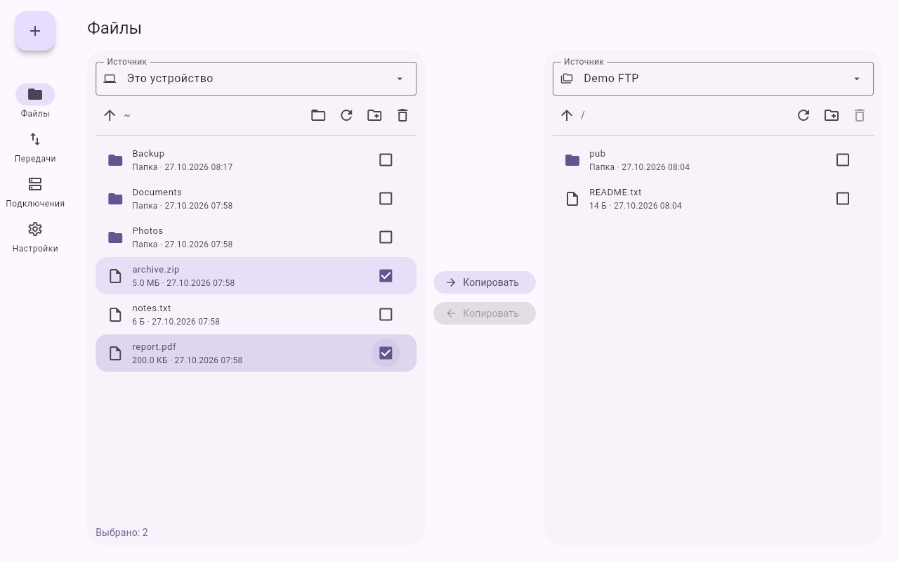
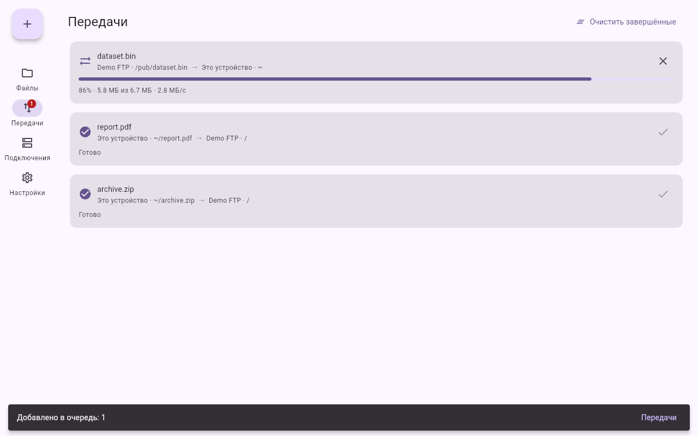
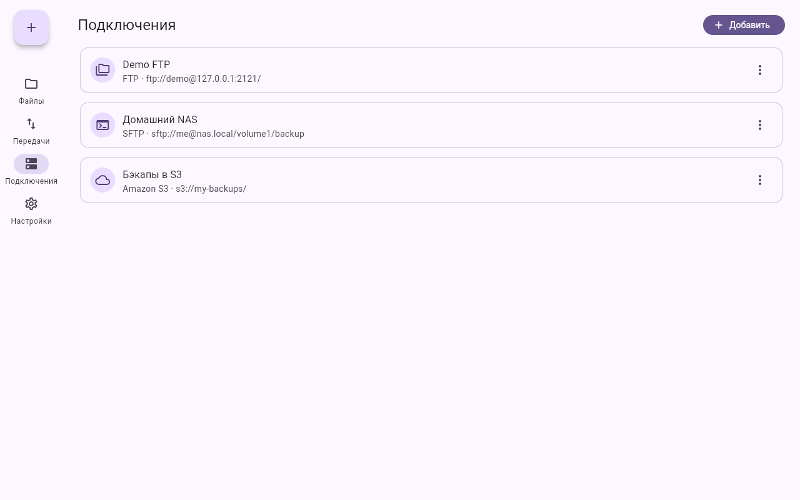
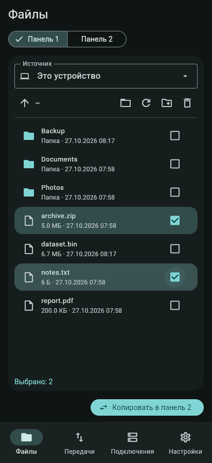

# File Transfer for All

[](https://github.com/Zaxar1231/File-transfer-for-all/actions/workflows/ci.yml)
[](https://github.com/Zaxar1231/File-transfer-for-all/releases/latest)
[](LICENSE)

Приложение для передачи файлов в стиле **Material You (Material Design 3)**. Работает с
SFTP, SMB (Windows, Samba, NAS), FTP/FTPS, WebDAV, Amazon S3 и S3-совместимыми
хранилищами, HTTP(S) и файлами на самом устройстве. Есть для Windows, macOS, Linux и Android.

## Скачать

Ссылки всегда ведут на последнюю версию.

| Платформа | Файл |
|---|---|
| **Windows** 10/11, x64 | [FileTransferForAll-windows-x64.zip](https://github.com/Zaxar1231/File-transfer-for-all/releases/latest/download/FileTransferForAll-windows-x64.zip) |
| **macOS**, Apple Silicon (M1–M4) | [FileTransferForAll-macos-arm64.zip](https://github.com/Zaxar1231/File-transfer-for-all/releases/latest/download/FileTransferForAll-macos-arm64.zip) |
| **macOS**, Intel | [FileTransferForAll-macos-x64.zip](https://github.com/Zaxar1231/File-transfer-for-all/releases/latest/download/FileTransferForAll-macos-x64.zip) |
| **Linux** x64 | [FileTransferForAll-linux-x64.tar.gz](https://github.com/Zaxar1231/File-transfer-for-all/releases/latest/download/FileTransferForAll-linux-x64.tar.gz) |
| **Linux** ARM64 (Raspberry Pi 4/5 и т. п.) | [FileTransferForAll-linux-arm64.tar.gz](https://github.com/Zaxar1231/File-transfer-for-all/releases/latest/download/FileTransferForAll-linux-arm64.tar.gz) |
| **Android**, любой процессор | [FileTransferForAll-android.apk](https://github.com/Zaxar1231/File-transfer-for-all/releases/latest/download/FileTransferForAll-android.apk) |
| Android, только ARM64 (большинство телефонов) | [FileTransferForAll-android-arm64-v8a.apk](https://github.com/Zaxar1231/File-transfer-for-all/releases/latest/download/FileTransferForAll-android-arm64-v8a.apk) |
| Android, ARMv7 (старые телефоны) | [FileTransferForAll-android-armeabi-v7a.apk](https://github.com/Zaxar1231/File-transfer-for-all/releases/latest/download/FileTransferForAll-android-armeabi-v7a.apk) |
| Android, x86_64 (эмуляторы, Chromebook) | [FileTransferForAll-android-x86_64.apk](https://github.com/Zaxar1231/File-transfer-for-all/releases/latest/download/FileTransferForAll-android-x86_64.apk) |

Все версии и контрольные суммы (`SHA256SUMS.txt`) — на [странице релизов](https://github.com/Zaxar1231/File-transfer-for-all/releases).

Сборки пока не подписаны, поэтому система предупредит при первом запуске:

- **Windows:** распакуйте архив и запустите `FileTransferForAll.exe`; в окне SmartScreen
  нажмите «Подробнее» → «Выполнить в любом случае».
- **macOS:** распакуйте архив и перетащите приложение в «Программы». Первый раз откройте
  его через правый клик → «Открыть» или выполните
  `xattr -dr com.apple.quarantine "/Applications/FileTransferForAll.app"`.
- **Linux:** `tar -xzf FileTransferForAll-linux-x64.tar.gz -C ~/FileTransferForAll` и
  запустите `~/FileTransferForAll/FileTransferForAll`. Сборка работает на дистрибутивах с
  glibc 2.35 и новее (Ubuntu 22.04+, Debian 12+, Fedora 36+).
- **Android:** откройте APK и разрешите установку из этого источника.

### Обновления

Приложение само проверяет при запуске, вышла ли новая версия, и предлагает обновиться.
На Android новая версия APK скачивается и сразу открывается системным установщиком. На
компьютере архив скачивается в «Загрузки» с прогрессом, и приложение показывает его в
файловом менеджере. Проверку можно выключить или запустить вручную в «Настройки →
Обновления».



| Передачи | Подключения | Телефон, тёмная тема |
|---|---|---|
|  |  |  |

## Возможности

- **Две панели, как в файловом менеджере.** Каждая показывает это устройство или любое
  сохранённое подключение. Файлы и папки копируются между панелями в обе стороны, в том
  числе напрямую сервер → сервер (например, FTP → S3).
- **Очередь передач.** Прогресс, скорость, отмена, повтор после ошибки, несколько передач
  одновременно. Бейдж на вкладке показывает, сколько передач идёт сейчас.
- **Подключения.** Форма подстраивается под протокол. Кнопка «Проверить» соединяется с
  сервером до сохранения. Пароль сохраняется только с галочкой «Запомнить», иначе
  приложение спросит его один раз за сеанс.
- **Докачка и проверка целостности.** Оборванная передача продолжается с места обрыва
  (HTTP Range, FTP REST, SFTP, SMB, S3, WebDAV). SHA-256 считается по всему файлу и по
  блокам 4 МиБ; с включённой проверкой копия сверяется с оригиналом.
- **Очередь с приоритетами.** Пауза и продолжение, «поднять наверх», автоповтор с
  нарастающей паузой (2, 4, 8… 60 с). Журнал всех передач с экспортом в CSV.
- **Рядом (как LocalSend).** Устройства в локальной сети находят друг друга сами
  (mDNS/Bonjour). Файлы и папки уходят напрямую по HTTPS, сохраняются структура папок,
  время изменения и права. Получатель подтверждает каждую передачу, по желанию с PIN.
  Сертификат устройства закрепляется по отпечатку из mDNS или QR-кода, чужое устройство
  с тем же адресом не примет файлы. Обрыв — передача продолжится без повторного вопроса.
- **Tor, IPFS, Tailscale.**
  - Tor: в подключении SFTP, WebDAV или HTTP кнопка «Tor» (`socks5h://127.0.0.1:9050`) —
    соединение и даже DNS идут через Tor, работают адреса `.onion`; терминал SSH тоже.
  - IPFS: `ipfs://CID/путь` читается через ваш узел (с проверкой блоков) или публичный
    шлюз, с докачкой; «Опубликовать в IPFS» в меню файлов добавляет файл на ваш узел и
    показывает CID, ссылку и QR-код.
  - Tailscale: устройства вашей сети Tailscale видны на вкладке «Рядом» из любой точки
    мира. Где запущено приложение — обычная прямая передача, где нет — Taildrop.
- **Фишки.** Код ↑↑↓↓←→←→BA включает режим «Сисадмин» (байты, попытки, полный SHA-256);
  «Вжух!» после передачи; ёжик бегает в прогрессе `fta cp` и отвечает на `ёж` в SSH-оболочке;
  «Рулетка» отправляет файлы случайному устройству рядом; «Таймер-бомба» — файлы
  самоуничтожаются у получателя через 5 минут — сутки (он видит это до приёма);
  «Мем-почта» — записка или случайный мем на соседнее устройство; «Статистика» и
  карточка итогов в SVG (`fta stats --card итоги.svg`).
- **Синхронизация и расписание.** `fta sync` и «Передачи → Расписание» зеркалируют папку:
  неизменённые файлы пропускаются, а у изменённого отправляются только изменившиеся блоки
  по 4 МиБ (SFTP, локальные и сетевые диски), без программы на сервере. Расписание —
  в выбранное время по дням недели; пропущенный запуск выполняется при открытии приложения.
- **Ограничение скорости** для всех передач вместе (Настройки или `fta --limit 2M …`).
- **Портативный режим.** Создайте папку `fta-data` рядом с программой — настройки, ключи
  и журнал будут храниться в ней, например на флешке.
- **Безопасность.**
  - Шифрование файлов в формате [age](https://age-encryption.org): паролем или ключами
    получателей (`age1…`). Файлы открываются и этим приложением, и официальной утилитой
    `age` (проверено тестами в обе стороны). Меню «⋮» на вкладке «Файлы».
  - Одноразовые ссылки: «Поделиться ссылкой» отдаёт файл или папку (zip) по HTTPS-ссылке
    и QR-коду на 10 минут — 7 дней; одноразовая ссылка гаснет после первого скачивания,
    любую можно отозвать на вкладке «Рядом».
  - Двухфакторный вход в SSH-сервер: пароль и код из Google Authenticator, Aegis,
    1Password (TOTP). Каждый код принимается один раз.
  - Входящие передачи подтверждаются вручную, по желанию с PIN; сертификаты устройств и
    ключи SSH-серверов закрепляются по отпечаткам.
  - Парсеры адресов, сетевые входы и формат age проверяются фаззингом (Hypothesis),
    зависимости — `pip-audit` в CI.
- **Облака.** Кнопка «Облако» на вкладке «Подключения»: выберите Google Drive, Dropbox,
  Яндекс.Диск, OneDrive, Mail.ru и другие — вход через браузер, пароль вводится только на
  сайте сервиса. Работает через [rclone](https://rclone.org): если его нет, приложение
  скачает официальную сборку и сверит SHA-256. Облака, уже настроенные в вашем rclone,
  добавляются одной кнопкой.
- **Встроенный SSH-терминал и подключение по IP.** Кнопка «По IP» на вкладке
  «Подключения»: введите адрес (`192.168.1.20`, `nas.local:2222`), логин и пароль — и
  откройте файлы сервера (SFTP, SMB, FTP, WebDAV) или терминал SSH, ничего не сохраняя.
  Терминал — полноценный xterm: цвета, `top`, `mc`, `nano`, `vim`, изменение размера
  окна, панель клавиш Esc/Tab/Ctrl+C/стрелки для телефона. Из терминала одной кнопкой
  открываются файлы того же сервера. Ключ сервера при первом входе показывается с
  отпечатком и запоминается, как в PuTTY; если он изменится, приложение предупредит.
- **SSH/SFTP-сервер для PuTTY** ([руководство со скриншотами](docs/putty.md)). Включается в настройках: PuTTY или `ssh` открывают
  оболочку передач (`send`, `recv`, `queue`, `peers`, `history`), psftp, WinSCP и
  FileZilla работают с общей папкой по SFTP. Вход по паролю (хранится только хеш) или
  по ключам из `authorized_keys`.
- **Работа с файлами.** Создание папок, удаление (папки — вместе с содержимым), скрытые
  файлы по желанию, выбор папки системным диалогом.
- **Material You.** Вся палитра строится из выбранного цвета акцента, есть светлая, тёмная
  и системная темы. На широком экране навигация слева (navigation rail с FAB), на телефоне
  внизу (navigation bar) и панели переключаются по одной.

## Запуск

```bash
python -m venv .venv && . .venv/bin/activate     # Windows: .venv\Scripts\activate
pip install -e .
fta-app                                          # или: python -m fta.app
```

При первом запуске Flet сам скачает свой десктопный клиент.

Настройки и подключения хранятся в `~/.config/fta/config.json` (Windows:
`%APPDATA%\fta`, macOS: `~/Library/Application Support/fta`, в собранном приложении —
в его каталоге данных). Файл доступен только текущему пользователю. Сохранённые пароли
лежат в нём открытым текстом, поэтому «Запомнить пароль» выключено по умолчанию.

## Сборка приложения

Сборкой занимается [Flet](https://flet.dev): Python-приложение упаковывается во Flutter.
Flutter SDK `flet build` скачивает сам при первой сборке.

```bash
pip install "flet[cli]==1.0.5"
flet build linux       # или: windows, macos, apk, aab, ipa
```

Готовая сборка появится в `build/<платформа>`. Настройки сборки (название, идентификатор,
путь к коду) лежат в `[tool.flet]` в `pyproject.toml`, иконка — в `src/assets/icon.png`.
Windows, macOS и iOS собираются на своей ОС; требования к каждой платформе описаны в
[документации Flet](https://flet.dev/docs/publish).

### Выпуск релиза

Все сборки делает workflow [`release.yml`](.github/workflows/release.yml) на GitHub Actions.

Релизы непрерывные: каждый pull request, который поднимает версию, после слияния в `main`
сам становится релизом.

1. Поднимите версию в `pyproject.toml` (`version`) и `src/fta/__init__.py` (`__version__`);
   тест проверяет, что они совпадают.
2. Влейте изменения в `main`. Workflow видит, что тега `v<версия>` ещё нет, собирает
   Windows, macOS, Linux x64/arm64 и Android, создаёт тег и релиз с файлами и
   `SHA256SUMS.txt`. Ссылки из раздела «Скачать» и проверка обновлений в приложении сразу
   начинают указывать на него.
3. Слияния без смены версии релиз не выпускают. Тег, поставленный вручную
   (`git tag v1.2.3 && git push origin v1.2.3`), тоже публикует релиз.

## Протоколы

| Протокол | Схема | Что умеет |
|---|---|---|
| Это устройство | путь, `file://` | всё |
| SFTP | `sftp` | всё; ключ хоста проверяется по `~/.ssh/known_hosts` |
| SMB 2/3 | `smb://server/share/...` | всё; первый сегмент пути — общий ресурс |
| Облака через rclone | `rclone://имя/путь` | Google Drive, Dropbox, Яндекс.Диск, OneDrive, Mail.ru, pCloud, Box, MEGA, Nextcloud и ещё 60+; докачка при скачивании |
| NFS | смонтированная папка | смонтируйте ресурс средствами системы (`mount -t nfs`, «Подключить сетевой диск») и работайте с ним как с папкой этого устройства |
| FTP / FTPS | `ftp`, `ftps` | всё; листинг требует MLSD (RFC 3659) |
| WebDAV | `dav`, `davs` | всё; стандартный WebDAV (RFC 4918) |
| Amazon S3 и совместимые | `s3` | всё; папки — это префиксы ключей |
| HTTP / HTTPS | `http`, `https` | скачивание, загрузка через PUT, без листинга |

## Командная строка

То же ядро доступно без интерфейса, например для скриптов:

```bash
fta cp -r ./photos sftp://me@nas.local/backup/ --dst-opt password=secret
fta cp ftp://user@host/pub/data.zip ./ --src-opt password=secret
fta ls s3://my-bucket/archive
fta stat dav://localhost:8080/docs/a.txt
fta mkdir -p ftp://user@host/new/dir --opt password=secret
fta rm sftp://me@nas.local/tmp/old.log
fta schemes

# докачка, проверка SHA-256 и три повтора
fta cp --resume --verify --retries 3 https://example.com/big.iso ./

# устройства рядом
fta peers
fta receive --qr                 # показать QR-код и принимать файлы
fta send "Ноутбук Ольги" ./photos  # по имени из fta peers
fta send "fta://192.168.1.20:53318/?fp=…" report.pdf  # по ссылке из QR-кода

# облака через rclone
fta cloud install                 # скачать rclone (с проверкой SHA-256)
fta cloud add work drive          # Google Drive: откроется браузер для входа
fta cloud add mail mailru user=me@mail.ru pass=пароль-приложения
fta cloud list
fta cp -r ./photos rclone://work/Фото

# синхронизация: второй раз уходят только изменившиеся блоки
fta sync ./фото sftp://me@nas.local/backup/фото --delete
fta --limit 2M cp -r ./видео @NAS:/видео

# шифрование и ссылки
fta keygen                        # мой публичный ключ age1…, чтобы другие шифровали для меня
fta encrypt отчёт.pdf             # спросит пароль → отчёт.pdf.age
fta encrypt -r age1… отчёт.pdf    # для владельца ключа
fta decrypt отчёт.pdf.age
fta share ./фото --ttl 1d         # ссылка и QR-код, гаснет после скачивания

# Tor, IPFS, Tailscale
fta ls sftp://me@abcdef…xyz.onion/ --opt proxy=socks5h://127.0.0.1:9050 --opt password=…
fta cp ipfs://bafybei…/video.mp4 ./     # через узел IPFS или шлюз ipfs.io
fta ipfs add отчёт.pdf                  # CID и ссылка
fta tailscale                           # устройства в сети Tailscale
fta tailscale nas ./фото.jpg            # FTA там запущено — напрямую, иначе Taildrop

# SSH/SFTP-сервер для PuTTY, WinSCP, psftp
fta serve --set-password
fta history -n 20 --csv journal.csv
```

## Архитектура

```
src/
├── main.py                  # точка входа для flet build
├── assets/icon.png
└── fta/
    ├── app/                 # приложение (Flet, Material 3)
    │   ├── main.py          #   оболочка: тема, адаптивная навигация, диалоги
    │   ├── storage.py       #   подключения и настройки (JSON)
    │   ├── transfers.py     #   очередь передач на фоновых потоках
    │   ├── updates.py       #   проверка и скачивание обновлений из GitHub Releases
    │   ├── ui.py            #   общие элементы и форматирование
    │   └── views/           #   экраны: browser, transfers, connections, settings, update
    ├── core/                # ядро, не зависит от интерфейса
    │   ├── transport.py     #   интерфейс Transport, прогресс, ошибки библиотек
    │   ├── registry.py      #   схема URL → транспорт, плагины
    │   ├── manager.py       #   copy(): файлы и папки между любыми двумя транспортами
    │   └── endpoint.py, errors.py
    ├── transports/          # local, http, webdav, ftp, sftp, smb, s3
    └── cli.py               # fta cp / ls / stat / mkdir / rm
```

- **Ядро отделено от интерфейса.** Приложение и CLI используют одни и те же транспорты и
  одну функцию `copy()`. Модель приложения (`storage.py`, `transfers.py`) тоже не зависит
  от Flet и покрыта обычными тестами.
- **Любой протокол с любым.** Транспорту достаточно уметь загрузку и скачивание: передача
  сервер → сервер идёт через временный файл.
- **Новый протокол** — это класс `Transport` с декоратором `@register` в `transports/`
  или пакет с entry point `fta.transports`. Ни ядро, ни интерфейс менять не нужно: схема
  появится в списке протоколов.

## Разработка

```bash
pip install -e ".[dev]"
pytest
```

Тесты протоколов поднимают настоящие серверы прямо в процессе: FTP (pyftpdlib), WebDAV и
HTTP (WsgiDAV + cheroot), SFTP (asyncssh), S3 (moto) и SMB (Samba). Сеть не нужна. Тест SMB
запускает `smbd`, поэтому нужен установленный Samba (`apt-get install samba`) и root или
`sudo` без пароля; иначе он пропускается. CI запускает тесты на Python 3.10–3.13.

Приложение можно открыть в браузере (удобно для отладки интерфейса):

```bash
python -c "import flet as ft; from fta.app.main import main; ft.run(main, view=ft.AppView.WEB_BROWSER)"
```

## Ограничения и планы

- Облака через rclone работают на Windows, macOS и Linux; на Android rclone не
  устанавливается, там облака недоступны.
- Загрузка в облако после обрыва начинается заново (облачные API принимают файл целиком);
  скачивание продолжается с места обрыва.
- На компьютере обновление скачивается автоматически, но заменить старую версию нужно
  вручную: сборки не подписаны, и бесшумная замена самого себя без подписи ненадёжна.
- Сборки для iOS нет: для неё нужен платный аккаунт Apple Developer.
- Передача «Рядом» работает внутри одной сети; через интернет и NAT — в следующих этапах.
- Передача сервер → сервер требует места на диске под самый большой файл.
- На Android и iOS доступ к файлам устройства ограничен песочницей приложения.

## Лицензия

[MIT](LICENSE)
