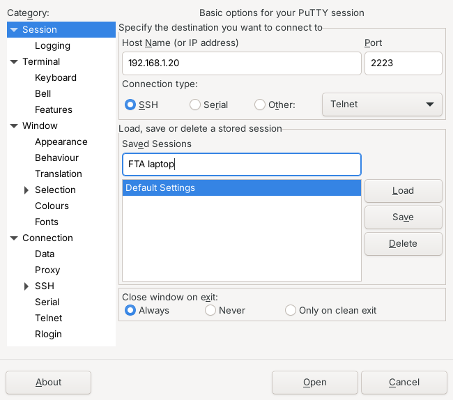
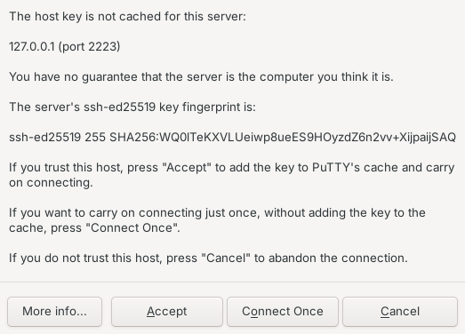
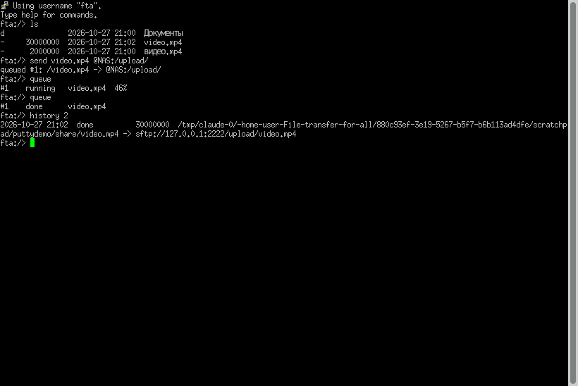

# PuTTY, psftp, WinSCP и ssh: подключение к File Transfer for All

Приложение умеет быть SSH-сервером. К нему подключаются:

* **PuTTY** (или `ssh`) — открывается *оболочка передач*: отправить файл из общей папки на
  любой сервер или в облако, скачать, посмотреть очередь и журнал;
* **psftp, WinSCP, FileZilla, `sftp`** — общая папка как обычный SFTP-сервер.

Скриншоты ниже сняты с настоящего PuTTY 0.81, подключённого к `fta serve`.

## 1. Включить сервер

В приложении: **Настройки → SSH-сервер** → «Включить сервер», задать пароль, при желании
выбрать общую папку (по умолчанию `~/FTA Shared`). Там же показаны адрес, порт и
**отпечаток ключа** сервера.

Без интерфейса, например на домашнем сервере:

```bash
fta serve --set-password          # один раз: пароль сохраняется только в виде хеша
fta serve --root ~/Общая --port 2222
```

`fta serve` печатает адреса и отпечаток:

```
Serving /home/me/Общая over SSH/SFTP on port 2222
Host key fingerprint: SHA256:WQ0lTeKXVLUeiwp8ueES9HOyzdZ6n2vv+XijpaijSAQ
  PuTTY:  host 192.168.1.20, port 2222, user fta
```

## 2. PuTTY

**Host Name** — адрес компьютера с приложением, **Port** — порт из настроек (2222 по
умолчанию), тип подключения — SSH. Сессию удобно сохранить.



При первом подключении PuTTY показывает отпечаток ключа сервера. **Сверьте его** с тем,
что показывает приложение (Настройки → SSH-сервер) или `fta serve`. Если совпадает —
«Accept»: PuTTY запомнит ключ и больше не спросит, а если ключ когда-нибудь изменится,
предупредит.



Логин — `fta` (меняется в настройках), пароль — тот, что вы задали. После входа —
оболочка передач. На скриншоте: файл из общей папки отправлен на NAS по сохранённому в
приложении подключению `@NAS`, очередь показывает прогресс, журнал — итог.



Команды оболочки:

| Команда | Что делает |
|---|---|
| `ls [папка]`, `cd`, `pwd` | ходить по общей папке (выйти за её пределы нельзя) |
| `send <файл> <куда>` | отправить файл или папку: URL (`sftp://…`, `s3://…`, `rclone://…`) или `@подключение:/путь` |
| `recv <откуда> [папка]` | скачать в общую папку |
| `queue`, `pause <id>`, `resume <id>`, `cancel <id>` | очередь передач (докачка после паузы) |
| `peers` | устройства «Рядом» и их SSH-порты |
| `history [n]`, `stats` | журнал и статистика |
| `ёж`, `вжух` | для долгих копирований |
| `help`, `exit` | |

Одну команду можно выполнить без входа в оболочку: `plink -P 2222 fta@192.168.1.20 queue`.

## 3. psftp и SFTP-клиенты

```text
$ psftp -P 2222 fta@192.168.1.20
psftp> ls
-rw-r--r--    1 root     root     30000000 Oct 27 21:02 video.mp4
drwxr-xr-x    2 root     root         4096 Oct 27 21:03 Документы
psftp> cd Документы
Remote directory is now /Документы
psftp> get отчёт.txt
remote:/Документы/отчёт.txt => local:отчёт.txt
```

Русские имена файлов работают, если в терминале локаль UTF-8 (`LANG=ru_RU.UTF-8` или
`C.UTF-8`); в Windows Terminal и PuTTY это так по умолчанию.

**WinSCP / FileZilla:** протокол SFTP, хост и порт как в PuTTY, логин `fta`. Корень, который
они видят, — общая папка; выйти из неё нельзя.

## 4. Вход по ключу (PuTTYgen)

1. В PuTTYgen: *Generate*, сохранить приватный ключ (`.ppk`).
2. Скопировать строку из поля «Public key for pasting into OpenSSH authorized_keys file».
3. Добавить её в файл `authorized_keys` в папке данных приложения (путь показан в
   Настройках; на Linux `~/.config/fta/authorized_keys`) и перезапустить сервер.
4. В PuTTY: *Connection → SSH → Auth → Credentials* → выбрать `.ppk`.

## 5. Двухфакторный вход

**Настройки → Безопасность → Двухфакторный вход**: отсканируйте QR-код приложением
(Google Authenticator, Aegis, 1Password) и введите первый код. После этого PuTTY и `ssh`
спрашивают пароль и код (keyboard-interactive; в PuTTY включено по умолчанию). Каждый код
принимается один раз. Вход по ключу из `authorized_keys` остаётся без кода.

## Если не подключается

* **Connection refused / timed out** — сервер выключен, другой порт или брандмауэр. Порт
  виден в Настройках; на Windows разрешите приложению доступ к частной сети.
* **Access denied** — неверный логин или пароль; при включённой 2FA нужен ещё и код.
* **WARNING – POTENTIAL SECURITY BREACH** в PuTTY — ключ сервера изменился. Так бывает после
  переустановки приложения с удалением данных; иначе не подключайтесь и выясните причину.
